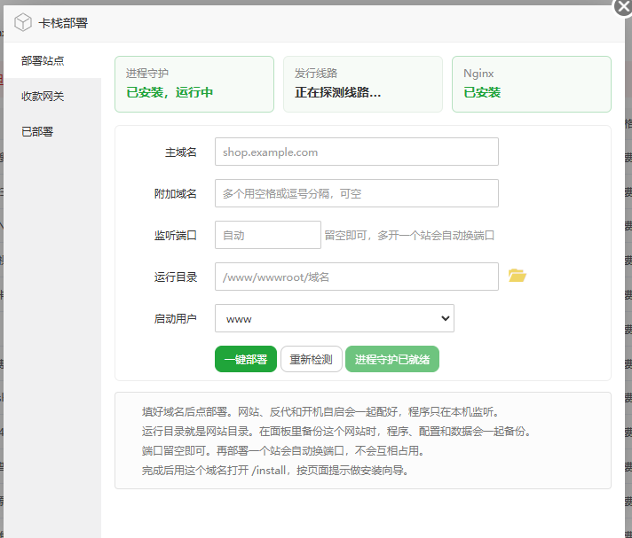

# 卡栈

数字商品销售 · 自动发卡 · 双向上下游供货。

Go 单二进制交付，内含商城与管理后台。支持 SQLite、MySQL、PostgreSQL。

## 怎么装

| 你的环境 | 怎么做 |
|---|---|
| **已装宝塔**（单站或同机多家店） | 下文本节「宝塔插件」 |
| Ubuntu / Debian 裸机，不要面板 | 「一键脚本」 |
| Docker | 见 [部署指南](https://cloudwebsite.github.io/kazhan/guide/deploy.html) |

装完打开 `http://你的域名/install`（或 IP）完成向导。装完配置清单：[装完先配这些](https://cloudwebsite.github.io/kazhan/guide/first-config.html)。

---

## 宝塔插件（推荐有面板的服务器）

插件名 **卡栈部署**：创建网站、反代、进程守护，按域名部署；同机多家店就再部署一次。

### 使用方法

1. 下载安装包：[kazhan_baota.zip](./kazhan_baota.zip)
2. 打开宝塔 → **软件商店** → **第三方应用 / 第三方插件** → **导入插件**
3. 选择刚下载的 `kazhan_baota.zip`，安装完成后打开插件「卡栈部署」
4. 软件商店先装好 **Nginx**；若还没有 **进程守护管理器**，插件会按面板流程安装
5. 填主域名（可加附加域名），运行目录默认 `/www/wwwroot/该域名`，启动用户默认 `www`
6. 部署完成后浏览器打开 `http://该域名/install`



同机多站说明：[同机多站点](https://cloudwebsite.github.io/kazhan/guide/multi-site.html)。  
不要和「一键脚本」同时管**同一套**实例。

---

## 一键脚本（无宝塔）

从 [Releases](https://github.com/cloudwebsite/kazhan/releases) 下载 `kazhan-linux-amd64` / `arm64` 与 `SHA256SUMS`（**不要**用 Source code 压缩包）。  
Ubuntu 22.04+ / Debian 12+：询问域名和数据库；公网域名会配 Nginx 与证书。选 MySQL 或 PostgreSQL 时，本机安装对应数据库和 Redis，并建库建账号。

```bash
curl -fsSL https://raw.githubusercontent.com/cloudwebsite/kazhan/main/scripts/kazhan-install.sh -o /tmp/kazhan-install.sh
sudo bash /tmp/kazhan-install.sh install
```

完整步骤：[部署指南](https://cloudwebsite.github.io/kazhan/guide/deploy.html) · 仓库内 [`doc/部署指南.md`](./doc/部署指南.md)。

国内访问 GitHub 较慢时，脚本会先走 `gh-proxy.com`、`ghfast.top`、`ghproxy.net`，失败再直连。终端不带参数会打开管理菜单。在线更新默认探测本仓库 Release（`update.json`）。

---

## 前台主题

内置 Classic，其余主题可安装。封面与后台主题卡片一致。

| Classic | 综合商城 | 蓝曜商城 | 轻透卡片 |
|---|---|---|---|
|  |  |  |  |

| 暖橙轻享 | 极速发卡 | 风尚卡片 | 二次元馆 |
|---|---|---|---|
|  |  |  |  |

## 文档

- 文档站：https://cloudwebsite.github.io/kazhan/
- 本仓库只含对外文档、精选说明、安装脚本与宝塔插件包；产品源码与 CI 在私有开发仓。

## License

见 [`LICENSE`](./LICENSE) / [`LICENSE.zh-CN.txt`](./LICENSE.zh-CN.txt)。
