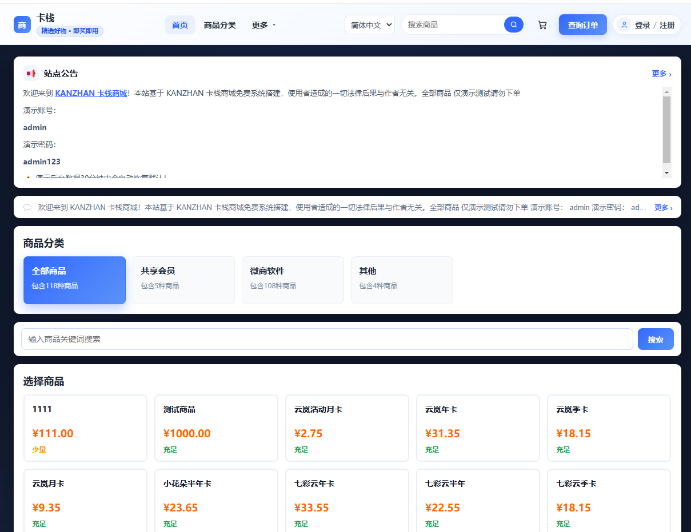

# 卡栈

数字商品销售 · 自动发卡 · 双向上下游供货。

Go 单二进制交付，内含商城与管理后台。支持 SQLite、MySQL、PostgreSQL。

## 下载与安装

1. 打开 [Releases](https://github.com/cloudwebsite/kazhan/releases)，下载对应架构的具名文件：
   - `kazhan-linux-amd64` / `kazhan-linux-arm64`
   - 校验：`SHA256SUMS`
2. **不要**下载 Release 页上的 Source code (zip/tar.gz) 当作安装包。
3. 一键安装（Ubuntu 22.04+ / Debian 12+）。会询问域名和数据库；公网域名自动配置 Nginx 与证书。选择 MySQL 或 PostgreSQL 时，会在本机安装该数据库和 Redis，并创建库与账号：

```bash
curl -fsSL https://raw.githubusercontent.com/cloudwebsite/kazhan/main/scripts/kazhan-install.sh -o /tmp/kazhan-install.sh
sudo bash /tmp/kazhan-install.sh install
```

4. 完整步骤见文档站 [部署指南](https://cloudwebsite.github.io/kazhan/guide/deploy.html)，或仓库内 [`doc/部署指南.md`](./doc/部署指南.md)。
5. 装完配置清单：[装完先配这些](https://cloudwebsite.github.io/kazhan/guide/first-config.html)。

在线更新默认探测本仓库 Release（签名清单 `update.json`）。

国内访问 GitHub 较慢时，安装脚本会先走 `gh-proxy.com`、`ghfast.top`、`ghproxy.net`，失败再直连。终端里不带参数会打开管理菜单。宝塔请使用面板插件「卡栈部署」，不要和本脚本同时管理同一实例。

## 前台主题

内置 Classic，其余主题可安装。封面与后台主题卡片一致。

| Classic | 综合商城 | 蓝曜商城 | 轻透卡片 |
|---|---|---|---|
|  |  |  |  |

| 暖橙轻享 | 极速发卡 | 风尚卡片 | 二次元馆 |
|---|---|---|---|
|  |  |  |  |

## 文档

- 文档站：https://cloudwebsite.github.io/kazhan/
- 本仓库只含对外文档、精选说明与安装脚本；产品源码与 CI 构建在私有开发仓。

## License

见 [`LICENSE`](./LICENSE) / [`LICENSE.zh-CN.txt`](./LICENSE.zh-CN.txt)。